# IMDb 50K Movie Reviews – Sentiment Analysis

## Research Title
**A Comparative Study of Neural Network and Deep Learning Models for Sentiment Analysis Using Natural Language Processing (NLP)**

## Project Overview
This research focuses on comparing different Neural Network and Deep Learning models for sentiment analysis using Natural Language Processing (NLP).

Using the IMDb 50K Movie Reviews dataset, four models—Artificial Neural Network (ANN), Simple Recurrent Neural Network (SimpleRNN), Long Short-Term Memory (LSTM), and Bidirectional LSTM (BiLSTM)—were implemented and evaluated to classify movie reviews as positive or negative.

## Dataset
- **Dataset:** IMDb Dataset of 50K Movie Reviews
- **Total Reviews:** 50,000
- **Positive Reviews:** 25,000
- **Negative Reviews:** 25,000
- **Source:** [Kaggle – IMDb Dataset of 50K Movie Reviews](https://www.kaggle.com/datasets/lakshmi25npathi/imdb-dataset-of-50k-movie-reviews)

## Technologies Used
- Python
- Google Colab
- TensorFlow / Keras
- Pandas and NumPy
- Matplotlib and Seaborn
- Scikit-learn
- Natural Language Processing (NLP)

## Models Implemented
1. Artificial Neural Network (ANN)
2. Simple Recurrent Neural Network (SimpleRNN)
3. Long Short-Term Memory (LSTM)
4. Bidirectional Long Short-Term Memory (BiLSTM)

## Methodology
1. Dataset loading and exploration
2. Text preprocessing and cleaning
3. Train-test splitting (80:20)
4. Tokenization and sequence padding
5. Neural network model implementation
6. Model training and validation
7. Performance evaluation
8. Comparative analysis

## Model Performance Comparison

| Model | Accuracy | Precision (Macro) | Recall (Macro) | F1-Score (Macro) |
|---|---:|---:|---:|---:|
| ANN | **89.10%** | 0.8913 | 0.8910 | 0.8910 |
| SimpleRNN | 49.80% | 0.4940 | 0.4980 | 0.3979 |
| LSTM | 53.57% | 0.5616 | 0.5357 | 0.4812 |
| BiLSTM | 87.86% | 0.8801 | 0.8786 | 0.8785 |

### Key Findings
- ANN achieved the highest test accuracy of 89.10%.
- BiLSTM achieved 87.86% accuracy, showing performance close to ANN.
- SimpleRNN and LSTM achieved lower accuracy in this experiment.
- ANN and BiLSTM showed stronger overall classification performance than the other two models.

## Research Visualizations

All research figures are available in the [`figures`](figures/) folder.

### Dataset Analysis

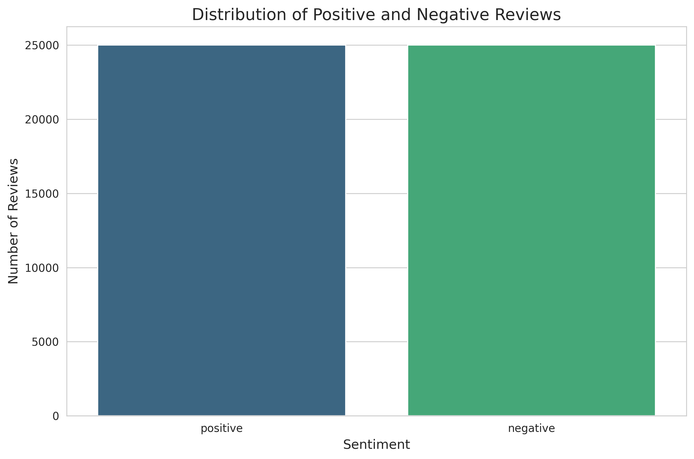

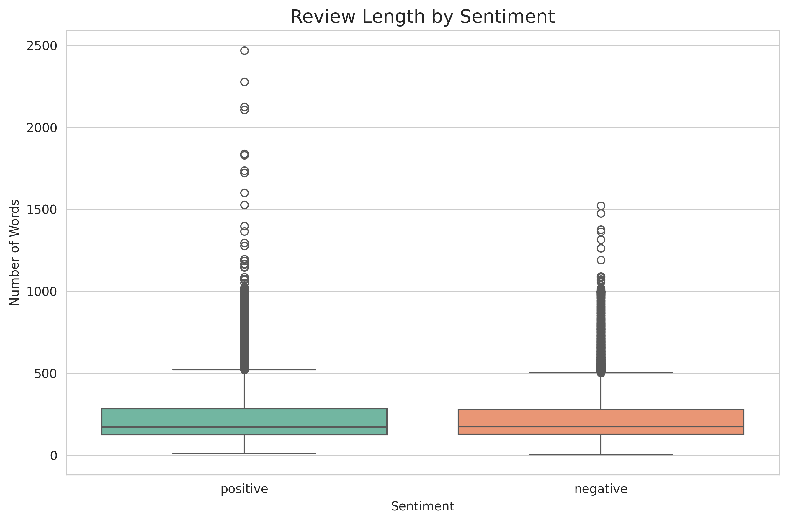

### Word Clouds

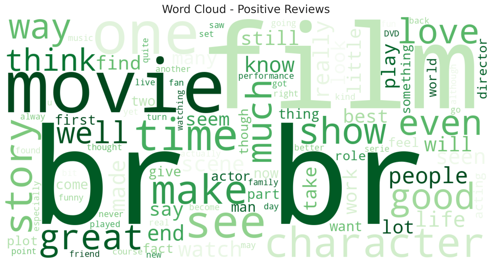

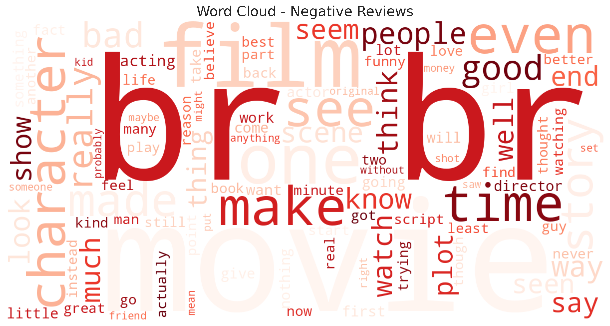

### Sequence Analysis

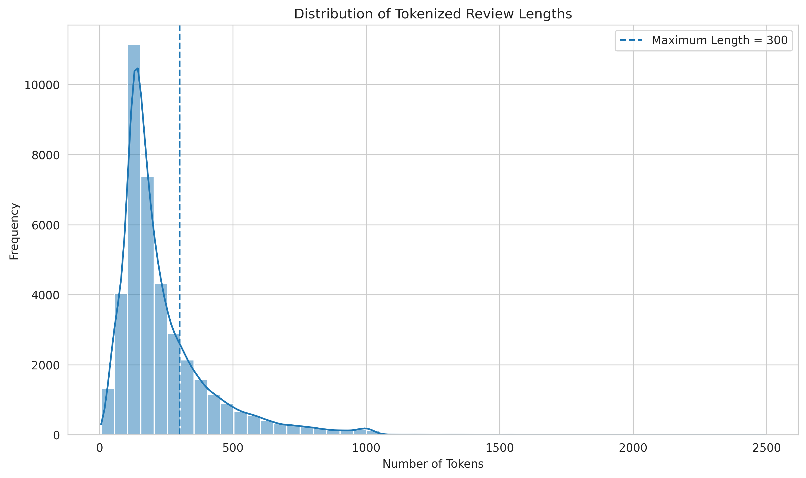

### ANN

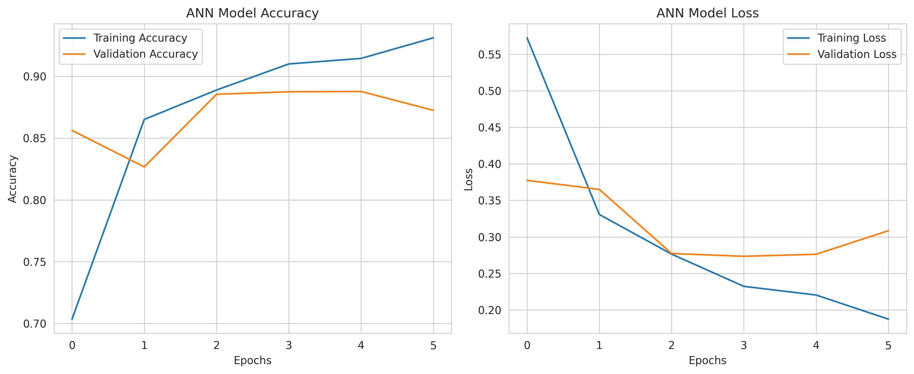

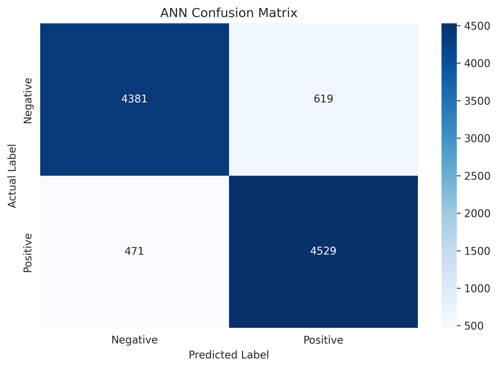

### SimpleRNN

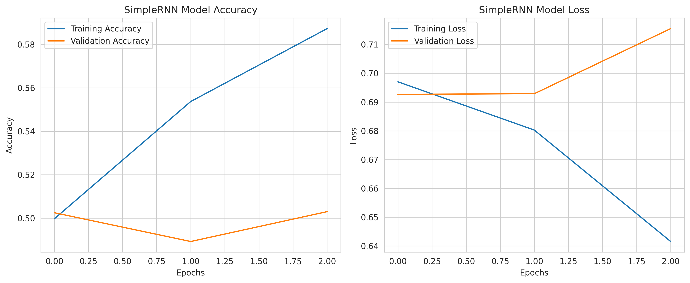

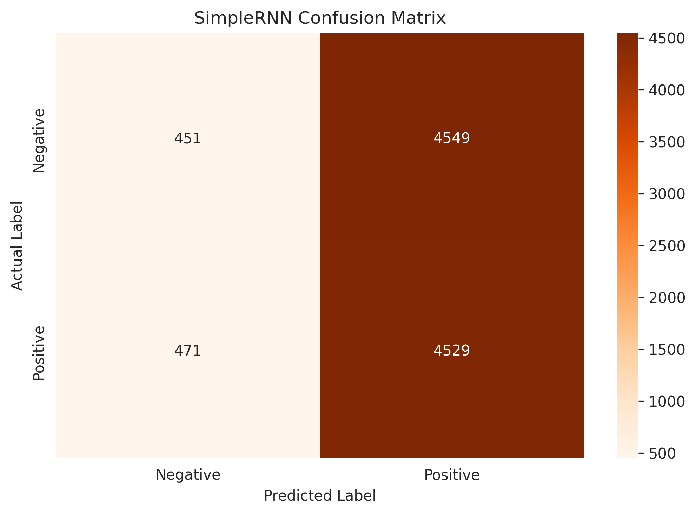

### LSTM

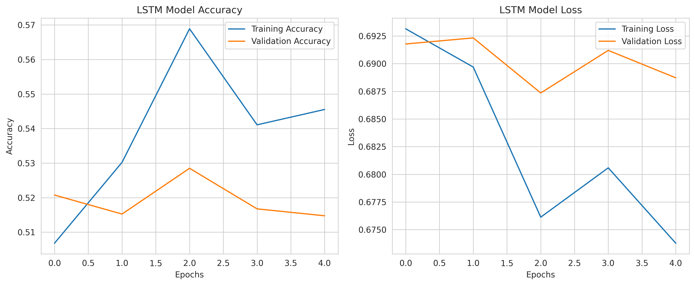

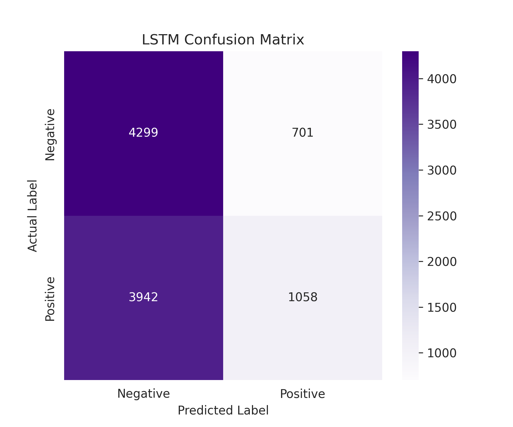

### BiLSTM

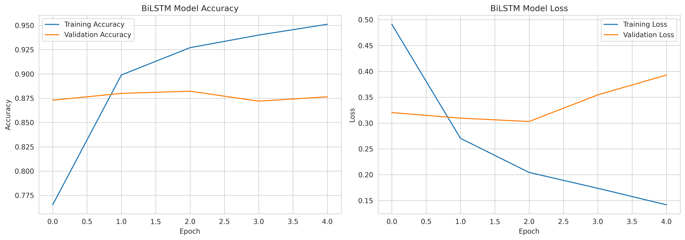

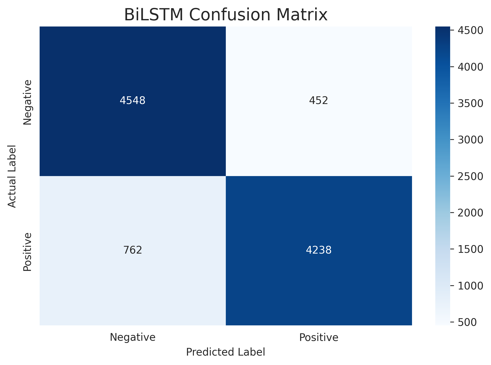

### Overall Model Comparison

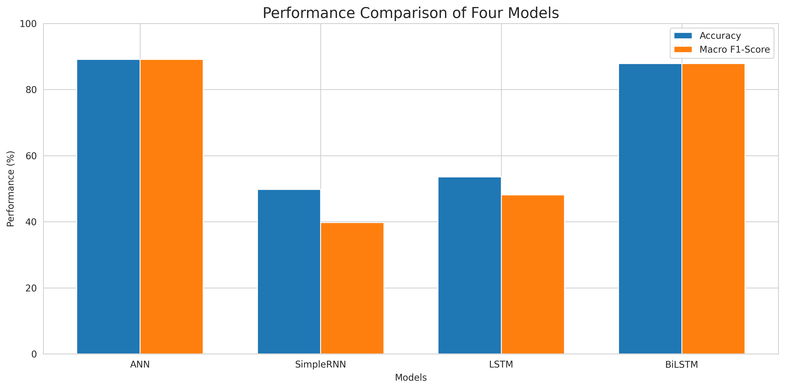

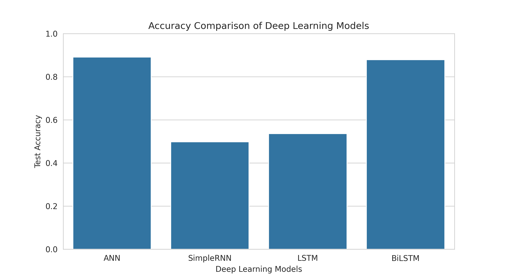

## Project Files
- [`Research Notebook`](IMDb_50K_Internship_Research.ipynb)
- [`Internship Research Report`](Internship_Report_Fahim_Shahriar_Mohammad_Sakib%20(1).pdf)
- [`Research Figures`](figures/)

## Research Limitations
- Duplicate records were identified but not removed before splitting the dataset, which may introduce data leakage.
- Reviews were limited to a maximum sequence length of 300 tokens.
- Only four neural network architectures were evaluated.
- Model performance may vary with different preprocessing methods and hyperparameters.

## Conclusion
This research compares four neural network architectures for sentiment analysis using the IMDb 50K Movie Reviews dataset. Based on the experimental results, ANN achieved the highest accuracy, while BiLSTM also demonstrated strong performance. The study provides practical insights into how different neural network architectures perform in NLP-based sentiment classification.

## Author
**Fahim Shahriar Mohammad Sakib**

Research Project – Internship

GitHub: [fahimsakib610](https://github.com/fahimsakib610)
